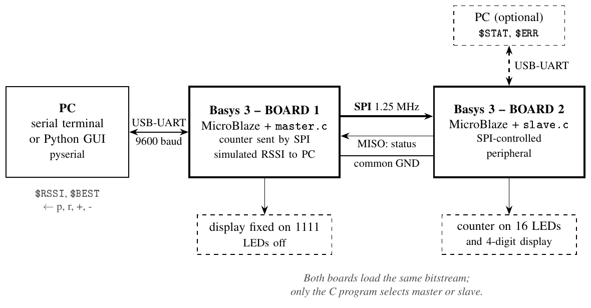
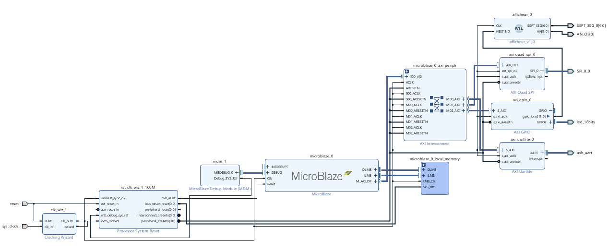
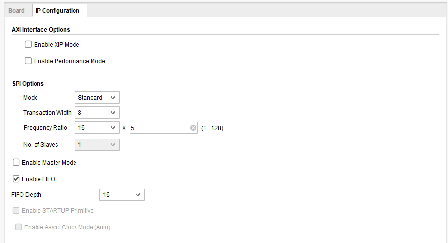
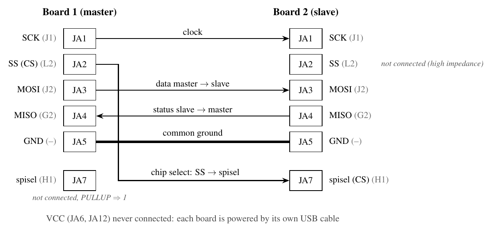
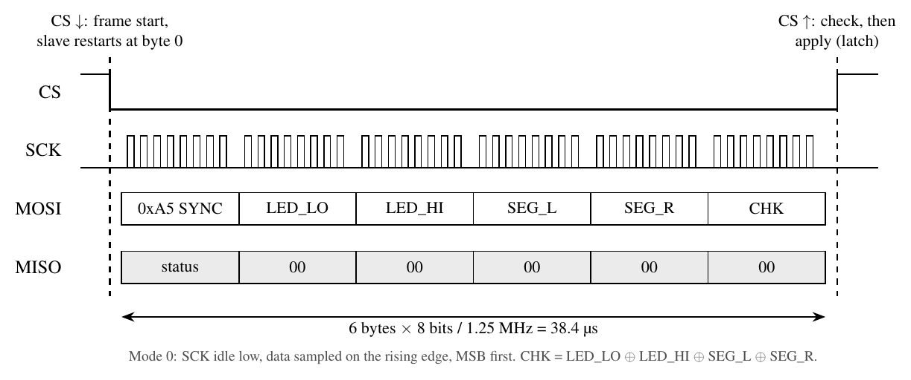

# MicroBlaze SPI / UART demo on two Basys 3 boards

**Briefing.** Two Digilent Basys 3 boards (Artix-7 XC7A35T) run the same FPGA design: a MicroBlaze soft processor with an AXI Quad SPI, an AXI UART Lite and an AXI GPIO. Board 1 (master) sends a counter to board 2 (slave) over SPI, in a 6-byte frame protected by a sync byte and a checksum. Board 2 shows the counter on its 16 LEDs (binary) and its 4-digit display (decimal). Board 1 also sends simulated RSSI measurements to a PC over UART. The only difference between the two boards is the C program, which selects the SPI role at start-up.

## Repository layout

| Folder | Content |
|---|---|
| `Board_1_Master/project/` | Full Vivado 2019.1 project (`Communication_SPI.xpr`) and SDK 2019.1 workspace (`Communication_SPI.sdk/`, application with `master.c`) |
| `Board_2_Slave/project/` | Same Vivado project, SDK workspace with the `Board2_Slave` application (`slave.c`) |
| `Board_X/vivado/` | Design sources only: `design_1_bd.tcl` (block design script), `design_1.bd`, `afficheur.vhd`, `pins.xdc` |
| `Board_X/bitstream/` | Exported hardware (`.hdf`, includes the bitstream), `.bit`, `.mmi` |
| `Board_X/sdk_src/` | C sources: `master.c` or `slave.c`, and `spi_frame.h` |

## Hardware (Vivado block design)

### Blocks and connections

| Block | Connections |
|---|---|
| **Clocking Wizard** `clk_wiz_1` | `clk_in1` ← `sys_clock` (100 MHz, board), `reset` ← `reset` (BTNC). `clk_out1` (100 MHz) clocks every block, including `ext_spi_clk` of the SPI and `CLK` of `afficheur`. `locked` → `dcm_locked` of the reset block. |
| **Processor System Reset** `rst_clk_wiz_1_100M` | `slowest_sync_clk` ← `clk_out1`, `ext_reset_in` ← `reset`, `mb_debug_sys_rst` ← MDM. `mb_reset` → MicroBlaze, `bus_struct_reset` → local memory, `interconnect_aresetn` → interconnect, `peripheral_aresetn` → all AXI resets. |
| **MicroBlaze** `microblaze_0` | Created with *Run Block Automation*: local memory, debug module (MDM), AXI data port. `DLMB`/`ILMB` → local memory, `M_AXI_DP` → interconnect `S00_AXI`, `DEBUG` ← MDM. |
| **Local memory** | 64 KB (set in the Address Editor). |
| **AXI Interconnect** `microblaze_0_axi_periph` | 1 slave port, 3 master ports: `M00` → UART Lite, `M01` → Quad SPI, `M02` → GPIO. |
| **AXI UART Lite** `axi_uartlite_0` | `UART` → board interface `usb_uart` (USB-UART of the Basys 3). |
| **AXI Quad SPI** `axi_quad_spi_0` | `SPI_0` → *Make External* → port `SPI_0_0` (Pmod JA). `ext_spi_clk` ← `clk_out1`. Interrupt not used. |
| **AXI GPIO** `axi_gpio_0` | Channel 1 (`gpio_io_o[15:0]`) → `HEX` of `afficheur`. Channel 2 → board interface `led_16bits` (16 LEDs). |
| **afficheur** (RTL module, `afficheur.vhd`) | 7-segment display driver, added with *Add Module*. `HEX[15:0]` ← GPIO channel 1, `SEPT_SEG[6:0]` and `AN[3:0]` → *Make External* → `SEPT_SEG_0`, `AN_0`. |

### Block settings

| Block | Setting | Value |
|---|---|---|
| AXI Quad SPI | Board tab | `SPI_0` = **Custom** (not `qspi_flash`) |
| | Mode / Transaction width | **Standard** / 8 bits |
| | Frequency ratio | **16 × 5 = 80** → SCK = 100 MHz / 80 = **1.25 MHz** |
| | No. of slaves | 1 |
| | Enable Master Mode | **unchecked** (master or slave, chosen in C) |
| | FIFO | enabled, depth 16 |
| | Enable STARTUP Primitive | **unchecked** |
| AXI GPIO | Dual channel | yes; channel 1: all outputs, 16 bits; channel 2: `led_16bits` |
| AXI UART Lite | Baud rate | 9600, 8 data bits, no parity |
| MicroBlaze | Local memory / Debug | 64 KB / enabled |

### Address map

| Block | Base address |
|---|---|
| Local memory (64 KB) | `0x0000_0000` |
| `axi_gpio_0` | `0x4000_0000` |
| `axi_uartlite_0` | `0x4060_0000` |
| `axi_quad_spi_0` | `0x44A0_0000` |

### Pin constraints (`pins.xdc`)

Clock, reset, UART and LEDs are placed by the Basys 3 board files. `pins.xdc` places the other ports (all LVCMOS33):

| Wrapper port | FPGA pin | Pmod | Note |
|---|---|---|---|
| `SPI_0_0_sck_io` | J1 | JA1 | SCK |
| `SPI_0_0_ss_io[0]` | L2 | JA2 | CS out (master), PULLUP |
| `SPI_0_0_io0_io` | J2 | JA3 | MOSI |
| `SPI_0_0_io1_io` | G2 | JA4 | MISO |
| `SPI_0_0_spisel` | H1 | JA7 | CS in (slave), PULLUP |
| `SEPT_SEG_0[6:0]` | W7 W6 U8 V8 U5 V5 U7 | — | segments |
| `AN_0[3:0]` | U2 U4 V4 W4 | — | anodes |

`spisel` is pulled up so that it stays high on the master (a low level would cause a *Mode Fault*).

## Wiring between the boards

| Board 1 | Board 2 | Signal |
|---|---|---|
| JA1 | JA1 | SCK |
| JA2 | **JA7** | CS (`ss_io` → `spisel`) |
| JA3 | JA3 | MOSI |
| JA4 | JA4 | MISO |
| JA5 | JA5 | GND (required) |

Do not connect the 3.3 V pins (JA6, JA12): each board is powered by its own USB cable. Wire with both boards switched off.

## SPI frame

SPI mode 0, MSB first, CS held low for the 6 bytes. Defined in `spi_frame.h`.

| Byte | Field | Content |
|---|---|---|
| 0 | SYNC | `0xA5` |
| 1 | LED_LO | LEDs 7..0 |
| 2 | LED_HI | LEDs 15..8 |
| 3 | SEG_L | left display, digits 3-2 |
| 4 | SEG_R | right display, digits 1-0 |
| 5 | CHK | LED_LO ⊕ LED_HI ⊕ SEG_L ⊕ SEG_R |

The slave applies a frame only when CS goes back high, and only if it is 6 bytes long, starts with `0xA5` and has a correct CHK. During the next frame it returns a status on MISO: `0x00` OK, `0xE1` length, `0xE2` sync, `0xE3` checksum.

## Software

**`master.c` (board 1)**
- SPI: `XSpi_Initialize`, `XSpi_SetOptions(XSP_MASTER_OPTION | XSP_MANUAL_SSELECT_OPTION)`, `XSpi_SetSlaveSelect(0x01)`, `XSpi_Start`, `XSpi_IntrGlobalDisable` (polled mode), then one `XSpi_Transfer` of 6 bytes per step.
- Every 100 ms: counter + 1, sent as LEDs (binary) and display (decimal, BCD). Its own display stays on `1111`.
- UART to the PC: `$RSSI,<step>,<angle>,<rssi>` per step and `$BEST,<step>,<angle>,<rssi>,<err>,<nack>` per 16-step scan (simulated RSSI).
- Commands from the PC: `p` pause, `r` run, `+` faster, `-` slower.

**`slave.c` (board 2)**
- SPI: `XSpi_SetOptions(0)` (slave), polled.
- Detects each frame with the *Slave Mode Select* bit of SPISR (bit 5 = 0 while CS is low), reads the RX FIFO, checks length, sync and CHK, then writes the GPIO.
- UART: `$STAT,ok=…,len=…,sync=…,chk=…` every 16 frames, `$ERR,…` on errors.

**Start-up signatures** (to check which program is on which board): board 1 shows `1111` + all LEDs for 1 s; board 2 shows `2222` + every other LED until the first valid frame.

## How to use

1. **Vivado 2019.1**: open `Board_X/project/Communication_SPI.xpr`. Synthesis/implementation results are not stored: run *Generate Bitstream* if you change the hardware. A ready bitstream is already in the SDK hardware platform.
2. **SDK 2019.1**: start SDK with `Board_X/project/Communication_SPI.sdk` as workspace, then *File → Import → General → Existing Projects into Workspace*, select that folder, import the 3 projects (hardware platform, BSP, application) and *Build All*.
3. **Program each board**: *Xilinx → Program FPGA*, *Device → Select…* the board's JTAG cable, and in *Software Configuration* replace `bootloop` with the application ELF. Click *Program*: the program starts immediately (with `bootloop`, the MicroBlaze does nothing and the display stays on `0000`). Program board 2 first, then board 1. Both boards must be powered.
4. **Terminal**: 9600 baud, 8N1, on each board's COM port.

Expected result: board 1 shows `1111`, board 2 counts on its LEDs and display, the PC receives `$RSSI` / `$BEST` lines.

To build from sources only: create a Basys 3 project, add `afficheur.vhd` and `pins.xdc`, run `source vivado/design_1_bd.tcl` in the Tcl console, create the HDL wrapper, generate the bitstream, export the hardware (include bitstream), then create two *Empty Application* projects in SDK and import `sdk_src/`.
