# Maquette SPI / UART MicroBlaze à deux cartes Basys 3

**Binôme : MOURADI Souhail — TABBABI Jawher**
ENSIL-ENSCI, spécialité Électronique et Télécommunications (ELT), 5e année, 2026-2027

Une carte Basys 3 **maître** (MicroBlaze) envoie des trames SPI à une seconde carte Basys 3 **esclave** et des lignes de mesure (RSSI simulé) à un PC par l'UART. L'esclave reçoit les trames, les contrôle et les applique sur ses LED et ses afficheurs 7 segments. Les deux cartes chargent **le même bitstream** : seul le programme C choisit le rôle.

| Dossier | Contenu |
|---|---|
| [`Carte_1_Maitre/`](Carte_1_Maitre) | Carte maître : **projet complet Vivado + SDK** (`projet/`), sources seules, bitstream, programme `maitre.c` |
| [`Carte_2_Esclave/`](Carte_2_Esclave) | Carte esclave : **projet complet Vivado + SDK** (`projet/`), mêmes sources Vivado et même bitstream, programme `esclave.c` |
| [`docs/figures/`](docs/figures) | Schémas et captures d'écran utilisés dans ce README |

---

## Sommaire

1. [Contexte, objectif et problématique](#1-contexte-objectif-et-problématique)
2. [Solutions proposées et choix](#2-solutions-proposées-et-choix)
3. [Le circuit dans Vivado](#3-le-circuit-dans-vivado)
4. [Broches et câblage](#4-broches-et-câblage)
5. [Protocole de trame SPI](#5-protocole-de-trame-spi)
6. [Programme du maître](#6-programme-du-maître)
7. [Programme de l'esclave](#7-programme-de-lesclave)
8. [Comment l'utiliser](#8-comment-lutiliser)
9. [Tests](#9-tests)
10. [Bilan et suite](#10-bilan-et-suite)

---

## 1. Contexte, objectif et problématique

### Contexte
Dans un projet de carte électronique à FPGA, un processeur logiciel **MicroBlaze** programmé en C doit piloter un périphérique en **SPI** (des consignes envoyées à chaque pas d'un balayage) et renvoyer des **mesures** à une IHM Python sur PC par une liaison série USB. Avant de dessiner la carte, nous validons cette chaîne sur des cartes de développement Digilent **Basys 3** (Artix-7 XC7A35T).

### Objectif
- une carte **maître** : à chaque pas d'un balayage simulé (16 pas), elle envoie une trame SPI et une ligne de mesure au PC ;
- une carte **esclave** : elle simule le périphérique SPI et applique la consigne sur ses LED et ses afficheurs ;
- un **PC** qui reçoit les mesures et envoie des commandes simples, première brique de l'IHM.

### Problématique
> Comment faire dialoguer de façon fiable un MicroBlaze et un périphérique commandé en SPI, et remonter des mesures vers une IHM, sans disposer encore de la carte finale ni du périphérique réel ?

| N° | Question | Section |
|---|---|---|
| Q1 | Comment configurer le bloc SPI de Vivado pour parler à une autre carte, et non à la flash de la Basys 3 ? | 3 |
| Q2 | Comment relier les signaux internes aux broches, et que faire des broches inutilisées ? | 3, 4 |
| Q3 | Comment l'esclave sait-il où commence une trame, à quoi elle sert, et si elle est juste ? | 5 |
| Q4 | Quel programme pour le maître, et quels messages vers le PC ? | 6 |
| Q5 | Comment un MicroBlaze esclave repère-t-il les trames sans piloter l'horloge ? | 7 |
| Q6 | Comment vérifier que tout fonctionne ? | 8, 9 |

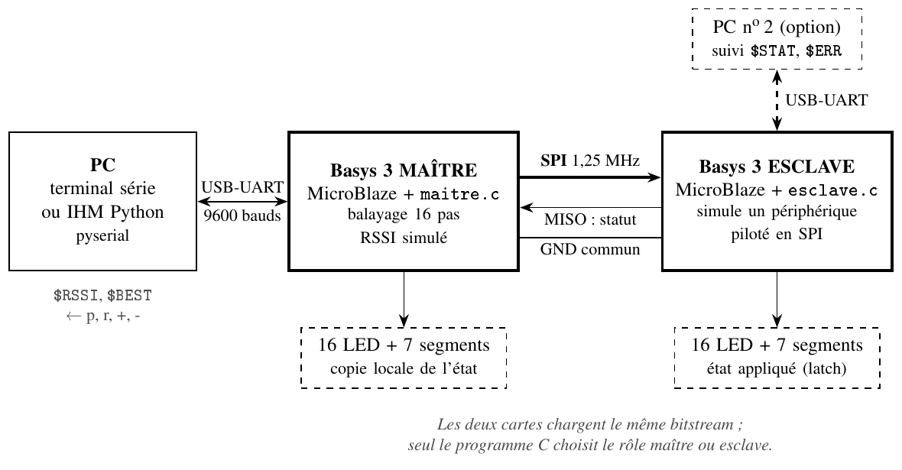

---

## 2. Solutions proposées et choix

**Banc de test.** Une seule carte et un analyseur logique montrent les signaux, mais rien ne reçoit les trames. Deux cartes reproduisent un vrai émetteur et un vrai récepteur → **deux cartes**.

**Carte esclave.**

| Solution | Avantages | Inconvénients |
|---|---|---|
| A. VHDL pur (récepteur SPI, décodeur, registres) | Plus proche d'un périphérique sans processeur ; pas de logiciel | Récepteur à écrire et simuler ; second projet Vivado |
| **B. MicroBlaze (retenue)** | Réutilise le TP ; décodage en C ; un seul projet | Mode esclave de l'AXI Quad SPI moins documenté |

**Un seul bitstream** pour les deux cartes : le programme C choisit maître ou esclave au démarrage. Il faut pour cela décocher *Enable Master Mode*, ce qui ajoute l'entrée `spisel`.

**Format des échanges.** Une **trame d'état de 6 octets** (tout l'état de l'esclave en une transaction) plutôt qu'une trame par registre. Vers le PC, des **lignes de texte** préfixées par `$`.

**LED et afficheurs.** AXI GPIO à 2 canaux, plus le module `afficheur.vhd` pour les 7 segments multiplexés. Pas de GPIO pour le SPI : l'AXI Quad SPI produit SCK, MOSI et CS en matériel (pas de *bit-banging*).

| Point | Choix |
|---|---|
| Banc de test | Deux Basys 3 reliées par Pmod JA |
| Esclave | MicroBlaze + AXI Quad SPI esclave |
| Bitstream | Commun aux deux cartes |
| Bloc SPI | Standard, 8 bits, 1,25 MHz, maître ou esclave |
| Trame SPI | 6 octets : SYNC, 4 données, CHK (XOR) |
| Vers le PC | Lignes `$RSSI`, `$BEST`… à 9600 bauds |

---

## 3. Le circuit dans Vivado

Projet Vivado 2019.1 `Communication_SPI`, block design `design_1`, identique sur les deux cartes.

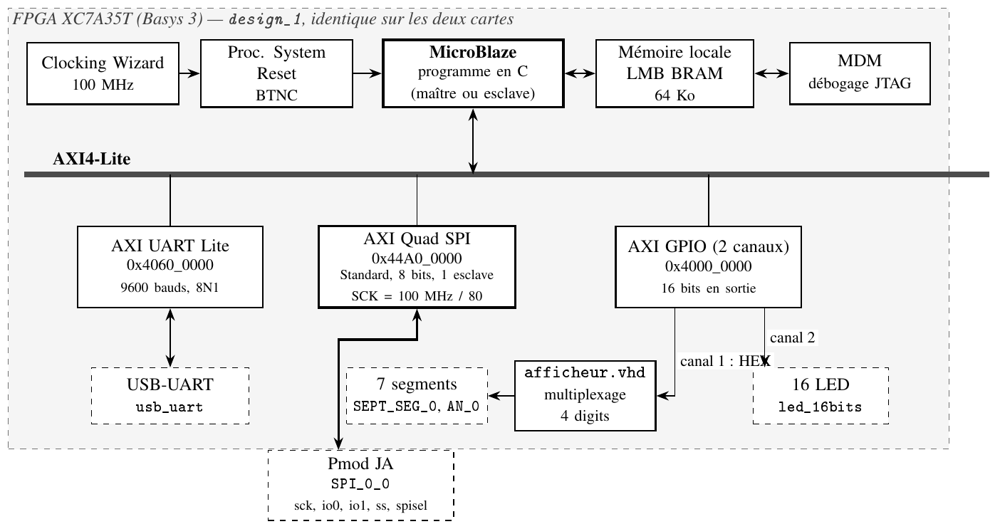
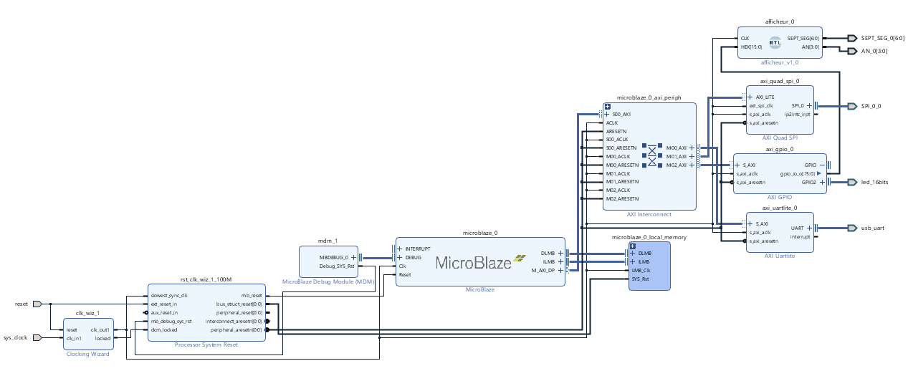

### Le problème de départ
Dans la première version, `SPI_0` était relié à `qspi_flash` (onglet *Board*), c'est-à-dire à la **flash de configuration** de la Basys 3, en mode *Quad* à 50 MHz. Les trames n'auraient jamais atteint l'autre carte.

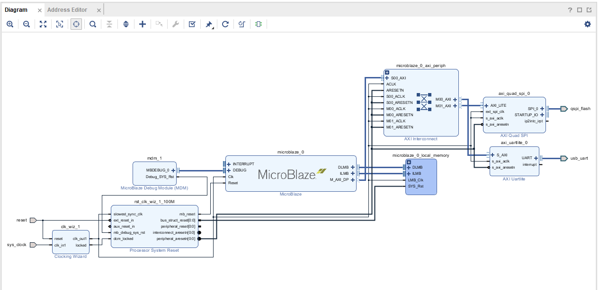

### Configuration retenue de l'AXI Quad SPI

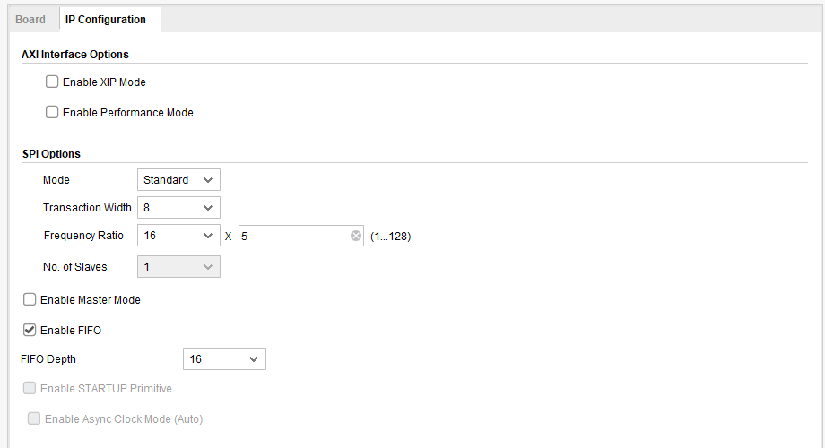

| Paramètre | Valeur | Pourquoi |
|---|---|---|
| Mode | Standard | SPI à 4 fils ; le mode Quad sert aux flash et n'accepte pas le rôle esclave |
| Transaction Width | 8 bits | Trame = suite d'octets |
| Frequency Ratio | 16 × 5 = 80 | SCK = 100 MHz / 80 = **1,25 MHz** (diviseur, pas un PLL) |
| No. of Slaves | 1 | Un CS, donc `ss` = vecteur `[0:0]` |
| Enable Master Mode | décoché | Maître **ou** esclave, choisi par le C |
| FIFO | 16 | Une trame de 6 octets y tient |
| Enable STARTUP Primitive | décoché | Sinon SCK part vers la broche CCLK de la flash |
| Board | Custom | Sinon le bloc est relié à `qspi_flash` |

### Signaux à trois états
Chaque ligne SPI est découpée en `_o` (à émettre), `_i` (lue) et `_t` (haute impédance). *Make External* sur l'interface `SPI_0` **entière** fait ajouter un **IOBUF** par ligne dans le wrapper, qui ne doit pas être modifié à la main.

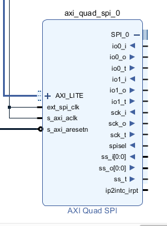 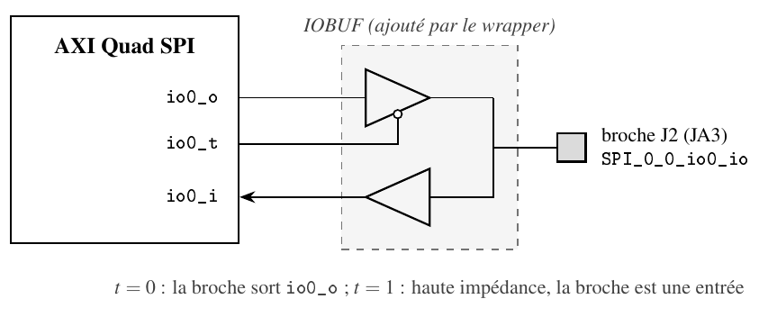

| Port du wrapper | Rôle |
|---|---|
| `SPI_0_0_sck_io` | SCK |
| `SPI_0_0_io0_io` | MOSI (io0 = MOSI en mode Standard) |
| `SPI_0_0_io1_io` | MISO |
| `SPI_0_0_ss_io[0]` | CS émis par le maître |
| `SPI_0_0_spisel` | CS reçu en mode esclave (actif à 0) |

### GPIO et afficheur
Canal 1 du GPIO → entrée `HEX` de `afficheur.vhd` (8 bits de poids fort = 2 digits de gauche, 8 bits de poids faible = 2 digits de droite). Canal 2 → `led_16bits` (à mettre en sortie dans le C).
**Correction de `afficheur.vhd`** : le compteur de `ENABLE` n'était jamais remis à 0 et `ENABLE` était affecté hors du front d'horloge. La version corrigée compte de 0 à 9 999 dans le front d'horloge (10 kHz, soit 2,5 kHz par digit), validée en simulation GHDL.

### Carte mémoire
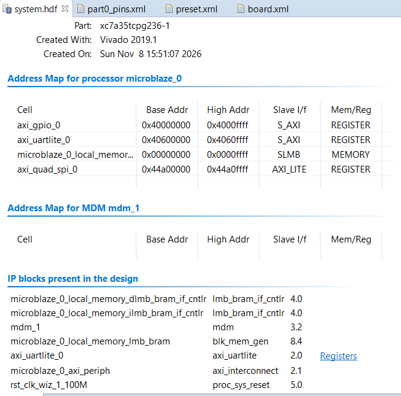

| Bloc | Base | Haut |
|---|---|---|
| Mémoire locale (64 Ko) | 0x0000_0000 | 0x0000_FFFF |
| `axi_gpio_0` | 0x4000_0000 | 0x4000_FFFF |
| `axi_uartlite_0` | 0x4060_0000 | 0x4060_FFFF |
| `axi_quad_spi_0` | 0x44A0_0000 | 0x44A0_FFFF |

---

## 4. Broches et câblage

| Port | Broche | Pmod | Propriétés |
|---|---|---|---|
| `SPI_0_0_sck_io` | J1 | JA1 | LVCMOS33 |
| `SPI_0_0_ss_io[0]` | L2 | JA2 | LVCMOS33, PULLUP |
| `SPI_0_0_io0_io` (MOSI) | J2 | JA3 | LVCMOS33 |
| `SPI_0_0_io1_io` (MISO) | G2 | JA4 | LVCMOS33 |
| `SPI_0_0_spisel` | H1 | JA7 | LVCMOS33, PULLUP |

Horloge, reset, UART et LED sont placés par le flot *Board*. Dans le XDC de Digilent, `JA[4]` est la **broche physique JA7** : se fier au commentaire `Sch name`.

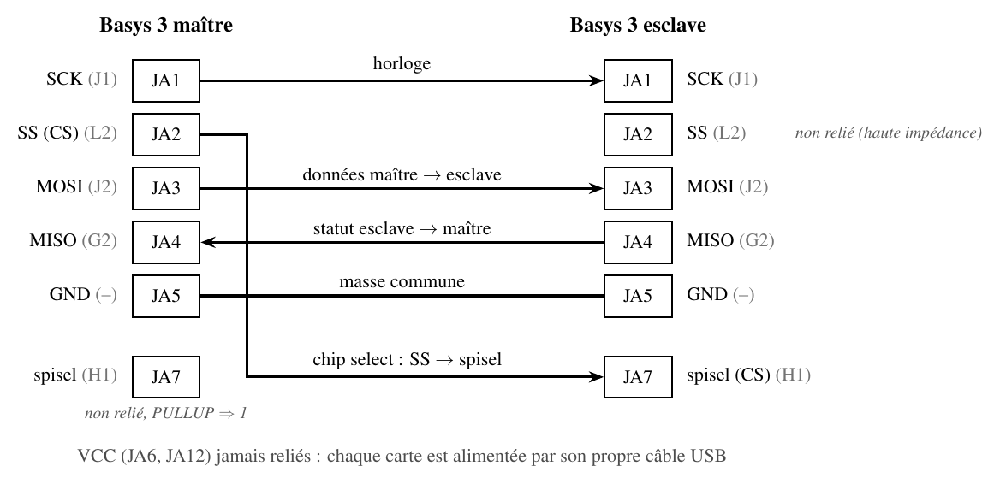

- **CS croisé** : `ss_io` du maître (JA2) → `spisel` de l'esclave (JA7). Les autres fils vont de JA*x* à JA*x*.
- **`spisel` du maître** : non relié, tiré à 1 par le PULLUP (sinon erreur *Mode Fault*).
- **`ss_io` de l'esclave** : non relié (haute impédance), **jamais à la masse**.
- **Masse commune** : JA5 ↔ JA5 obligatoire. **Ne jamais relier les 3,3 V** (JA6, JA12).

---

## 5. Protocole de trame SPI

Mode 0 (CPOL = 0, CPHA = 0), MSB en premier, **un seul passage de CS à 0 par trame**. Défini dans `trame_spi.h`, identique sur les deux cartes.

| Octet | Champ | Contenu |
|---|---|---|
| 0 | SYNC | `0xA5` |
| 1 | LED_LO | LED 7..0 |
| 2 | LED_HI | LED 15..8 |
| 3 | AFF_G | afficheur gauche → `HEX(15:8)` |
| 4 | AFF_D | afficheur droit → `HEX(7:0)` |
| 5 | CHK | LED_LO ⊕ LED_HI ⊕ AFF_G ⊕ AFF_D |

Exemple : LED0, LED7, LED10 à 13, « 12 » à gauche, « AB » à droite → `A5 81 3C 12 AB 04`.

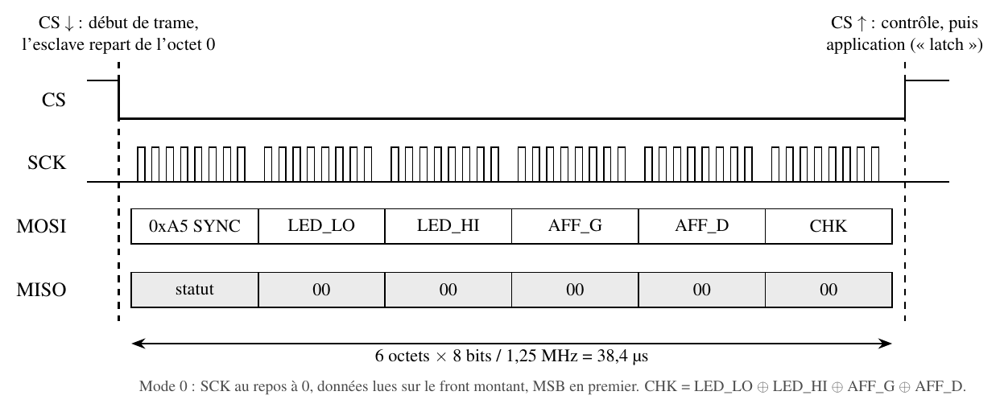

L'esclave n'applique la trame **qu'à la remontée de CS** (comme un registre à verrou, *latch enable*), et seulement si elle fait 6 octets, commence par `0xA5` et a un CHK juste. Pendant la trame suivante, il renvoie sur MISO un statut : `0x00` OK, `0xE1` longueur, `0xE2` SYNC, `0xE3` CHK. Le CS est indispensable même avec un seul esclave : il recale l'esclave sur l'octet 0 à chaque trame et marque le moment d'appliquer la consigne.

---

## 6. Programme du maître

[`Carte_1_Maitre/sdk_src/maitre.c`](Carte_1_Maitre/sdk_src/maitre.c)

| Appel | Rôle |
|---|---|
| `XSpi_Initialize(&Spi, XPAR_SPI_0_DEVICE_ID)` | Initialisation du driver |
| `XSpi_SetOptions(&Spi, XSP_MASTER_OPTION \| XSP_MANUAL_SSELECT_OPTION)` | Passage en maître, CS bas pendant les 6 octets |
| `XSpi_SetSlaveSelect(&Spi, 0x01)` | Esclave n° 0 |
| `XSpi_Start`, `XSpi_IntrGlobalDisable` | Activation, mode polling |

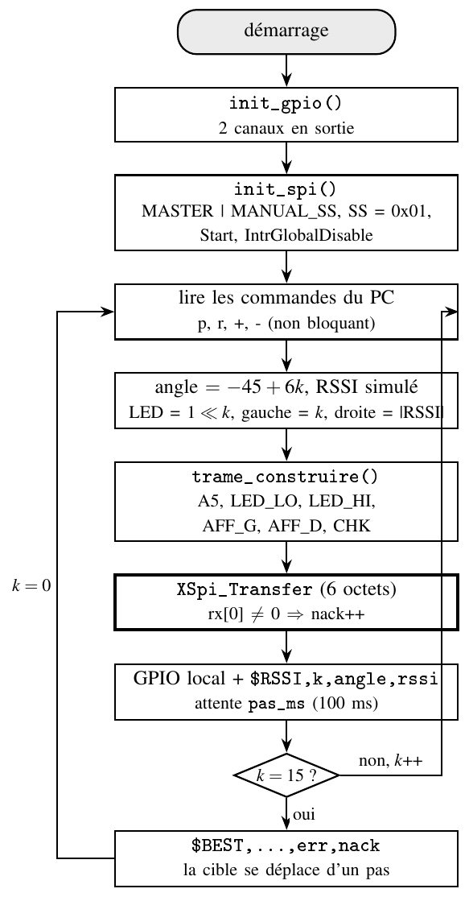

16 pas de −45° à +45°. Au pas *k* : LED *k* allumée, *k* à gauche, |RSSI| à droite (en BCD), RSSI simulé (−40 dBm sur la cible, −4 dB par pas d'écart, ±2 dB de bruit). Le maître montre aussi l'état sur ses propres LED : **les deux cartes doivent afficher la même chose**.

| Sens | Format |
|---|---|
| carte → PC | `$RSSI,<pas>,<angle>,<rssi>` (une ligne par pas) |
| carte → PC | `$BEST,<pas>,<angle>,<rssi>,<err_spi>,<nack>` (bilan d'un balayage) |
| carte → PC | `$INFO,…`, `$ERR,…`, `$ACK,…` |
| PC → carte | `p` pause, `r` reprise, `+` / `-` vitesse (50 ms à 1 s par pas) |

---

## 7. Programme de l'esclave

[`Carte_2_Esclave/sdk_src/esclave.c`](Carte_2_Esclave/sdk_src/esclave.c)

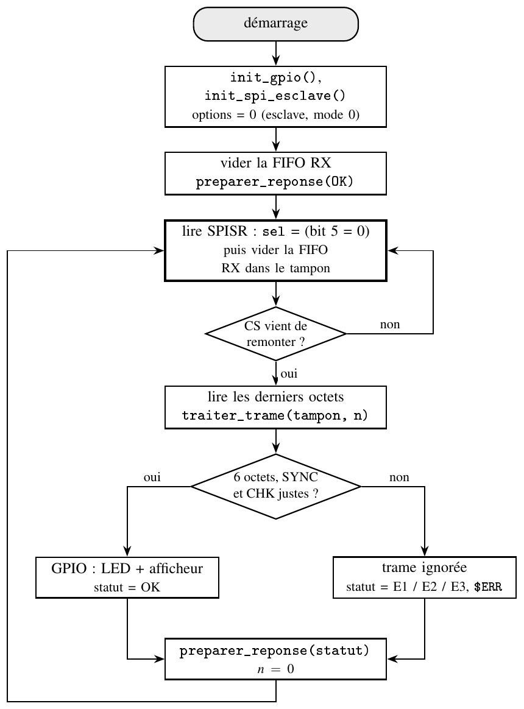

- Configuration esclave : `XSpi_SetOptions(&Spi, 0)`.
- Le bit **Slave Mode Select** de SPISR (bit 5) vaut 0 tant que le maître tient `spisel` à 0. La boucle lit ce bit **avant** de vider la FIFO de réception : quand on voit CS remonter, le dernier octet est déjà dans la FIFO.
- À la fin de la trame : contrôle longueur / SYNC / CHK, écriture sur le GPIO, puis préparation du statut dans la FIFO d'émission.
- UART : un bilan `$STAT,ok=…` toutes les 16 trames et une ligne `$ERR,…` à chaque erreur, écrits juste après une trame. À 9600 bauds, une ligne prend environ 45 ms, d'où un pas minimal de 50 ms côté maître.

---

## 8. Comment l'utiliser

### Matériel
- 2 cartes Digilent Basys 3 et 2 câbles micro-USB
- 5 fils femelle-femelle
- Vivado 2019.1 et Xilinx SDK 2019.1 (ou Vivado + Vitis Classic)
- Un terminal série (Tera Term, PuTTY, Hercules…) ou Python 3 + `pyserial`

### Option 1 : ouvrir directement les projets complets (recommandé)
Chaque carte contient un dossier `projet/` avec le projet Vivado 2019.1 et l'espace de travail SDK 2019.1 :
```
CarteX/projet/
├── Communication_SPI.xpr          ← projet Vivado
├── Communication_SPI.srcs/        ← block design, IP, afficheur.vhd, pins.xdc
└── Communication_SPI.sdk/
    ├── design_1_wrapper.hdf
    ├── design_1_wrapper_hw_platform_0/   ← plateforme matérielle (+ .bit)
    ├── Communication_SPI_BASYS3_bsp/     ← BSP (drivers xspi, xgpio, uartlite)
    └── Communication_SPI_BASYS3/         ← application (maitre.c ou esclave.c)
```
1. **Vivado** : *File → Open Project* → `CarteX/projet/Communication_SPI.xpr`. Les résultats de synthèse et d'implémentation (`.runs`, `.cache`) ne sont pas versionnés : lancer *Generate Bitstream* pour les recréer.
2. **SDK** : lancer SDK 2019.1 en choisissant comme espace de travail le dossier `CarteX/projet/Communication_SPI.sdk`, puis *File → Import → General → Existing Projects into Workspace*, sélectionner ce même dossier et cocher les 3 projets (plateforme, BSP, application). *Project → Build All*.
3. Programmer la carte et lancer l'application (*Program FPGA*, puis *Run As → Launch on Hardware*).

Les journaux, les fichiers `.metadata` de SDK et les dossiers `Debug` ne sont pas inclus : ils contiennent des chemins propres à un PC et sont regénérés automatiquement.

### Option 2 : utiliser seulement le bitstream fourni
Le dossier `bitstream/` de chaque carte contient le fichier `design_1_wrapper.hdf` exporté (qui inclut le bitstream) et le `.bit`. Le bitstream est **le même** pour les deux cartes.
> Ce bitstream a été généré le 8 novembre 2026, avant la correction de `afficheur.vhd` et l'ajout du pull-up sur `ss_io` dans `pins.xdc`. Il fonctionne, mais regénère-le avec les sources du dossier `vivado/` pour profiter de ces corrections.

### Option 3 : tout recréer à partir des sources

#### 1. Recréer le matériel (Vivado 2019.1)
1. Créer un projet RTL pour la carte **Basys 3** (onglet *Boards*), en VHDL.
2. *Add Sources* : `vivado/afficheur.vhd` ; *Add Constraints* : `vivado/pins.xdc`.
3. Recréer le block design : dans la console Tcl de Vivado, `source vivado/design_1_bd.tcl` (script extrait de l'export matériel). On peut aussi ajouter directement `vivado/design_1.bd`. Puis *Validate Design*, puis clic droit sur `design_1` → *Create HDL Wrapper* (laisser Vivado le gérer ; `design_1_wrapper.vhd` est fourni seulement pour référence).
4. *Generate Bitstream*, puis *File → Export → Export Hardware* en cochant **Include bitstream**.

#### 2. Créer les deux applications (SDK 2019.1)
1. *File → Launch SDK* (ou *New Application Project* → *New…* et choisir le `.hdf`). Vérifier que le processeur est **`microblaze_0`** et non `ps7_cortexa9_0` (plateforme ZC702 proposée par défaut).
2. **Maître** : *New → Application Project*, nom `Carte1_Maitre`, modèle *Empty Application*. Clic droit sur `src` → *Import → General → File System* → `Carte_1_Maitre/sdk_src/` (`maitre.c`, `trame_spi.h`).
3. **Esclave** : *New → Application Project*, nom `Carte2_Esclave`, même plateforme, BSP existant, *Empty Application*. Importer `Carte_2_Esclave/sdk_src/` (`esclave.c`, `trame_spi.h`).
4. *Project → Build All* : les deux `.elf` doivent se créer sans erreur.

### 3. Câbler
Cartes **hors tension**, relier les connecteurs JA comme sur la figure de câblage :

| Maître | Esclave | Signal |
|---|---|---|
| JA1 | JA1 | SCK |
| JA2 | **JA7** | CS (`ss_io` → `spisel`) |
| JA3 | JA3 | MOSI |
| JA4 | JA4 | MISO |
| JA5 | JA5 | GND |

### 4. Programmer et lancer
1. Brancher les deux cartes au PC.
2. *Xilinx → Program FPGA* : choisir la carte esclave (câble JTAG), programmer. Puis *Run As → Launch on Hardware* sur `Carte2_Esclave` (onglet *Target Setup* de la configuration de lancement : choisir le même câble).
3. Même chose avec la carte maître et `Carte1_Maitre`.
4. Ouvrir un terminal à **9600 bauds, 8N1** sur le port COM de chaque carte. Appuyer sur **BTNC** (reset) si rien ne s'affiche.

### 5. Lire les mesures en Python
```python
import serial
with serial.Serial("COM5", 9600, timeout=1) as s:      # port COM du maître
    while True:
        ligne = s.readline().decode(errors="replace").strip()
        if ligne.startswith("$RSSI"):
            _, pas, angle, rssi = ligne.split(",")
            print(f"angle {int(angle):+4d}°  RSSI {int(rssi)} dBm")
        elif ligne:
            print(ligne)
```
Envoyer `s.write(b"p")` pour mettre en pause, `b"r"` pour reprendre, `b"+"` / `b"-"` pour changer la vitesse.

### Dépannage
- **Rien dans le terminal** : vérifier 9600 bauds et le port COM, appuyer sur BTNC.
- **`$ERR,SPI_…`** : le code indique l'étape d'initialisation en échec.
- **L'esclave ne bouge pas** : masse commune, fil JA2 → JA7, puis SCK et MOSI à l'analyseur.
- **`$ERR,LONG` en continu** : CS mal relié, ou pas de balayage trop court.
- **Afficheurs à 0000 des deux côtés** : canal 1 du GPIO non relié à `HEX`.

---

## 9. Tests

| N° | Essai | Résultat attendu | État |
|---|---|---|---|
| T1 | Maître seul, démarrage | `$INFO,… maitre … demarre`, `$INFO,SPI maitre OK` | à faire |
| T2 | Maître seul, balayage | LED qui avance de 0 à 15, 16 `$RSSI` puis `$BEST` | à faire |
| T3 | SCK et CS à l'analyseur | 6 salves de 8 fronts à 1,25 MHz pendant CS = 0 (≈ 39 µs) | à faire |
| T4 | Deux cartes reliées | Mêmes LED et afficheurs sur les deux cartes | à faire |
| T5 | Bilans de l'esclave | `$STAT,ok=16,long=0,sync=0,chk=0`, puis 32, 48… | à faire |
| T6 | Champ `nack` de `$BEST` | Reste à 0 | à faire |
| T7 | MOSI débranché | `$ERR,SYNC` ou `$ERR,CHK`, l'esclave garde son état | à faire |
| T8 | CS débranché | Plus aucune trame appliquée, reprise au rebranchement | à faire |
| T9 | Commandes `p`, `r`, `+`, `-` | `$ACK,…` et changement de vitesse | à faire |

Les deux programmes compilent sans erreur ni avertissement (`-Wall -Wextra`) avec les en-têtes du BSP SDK 2019.1. Les essais sur carte restent à faire.

---

## 10. Bilan et suite

La chaîne MicroBlaze → SPI → périphérique et MicroBlaze → UART → PC est entièrement décrite et implantée : bloc SPI configuré pour une liaison carte à carte, broches et câblage justifiés, trame protégée par un octet de synchronisation et un contrôle d'erreur, application synchronisée sur la remontée de CS, messages lisibles par une IHM.

Prochaines étapes : dérouler la grille de test ; pour une carte toujours maître, cocher *Enable Master Mode* (plus de `spisel`, plus de risque de *Mode Fault*) ; passer l'UART à 115 200 bauds ; écrire l'IHM Python (RSSI = f(angle) en temps réel) ; envisager un CRC-8 pour des liaisons plus longues.

### Sources
- AMD, *AXI Quad SPI LogiCORE IP Product Guide* (PG153), v3.2
- Digilent, *Basys 3 Reference Manual* et *Pmod Interface Specification*
- Xilinx SDK 2019.1, drivers `spi_v4_4`, `gpio_v4_4`, `uartlite_v3_2`
- *TP de Système on Chip : MicroBlaze*, ENSIL-ENSCI — module `afficheur.vhd`

---
*MOURADI Souhail — TABBABI Jawher · ENSIL-ENSCI ELT 5A · 2026-2027*
